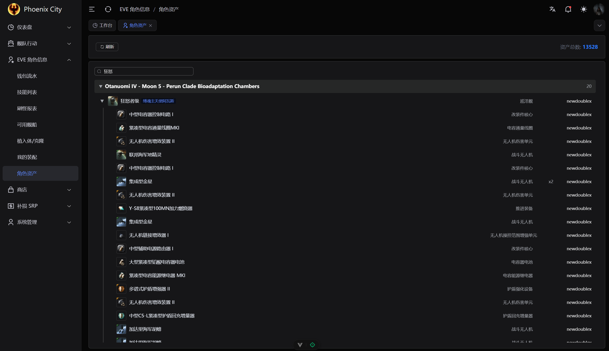
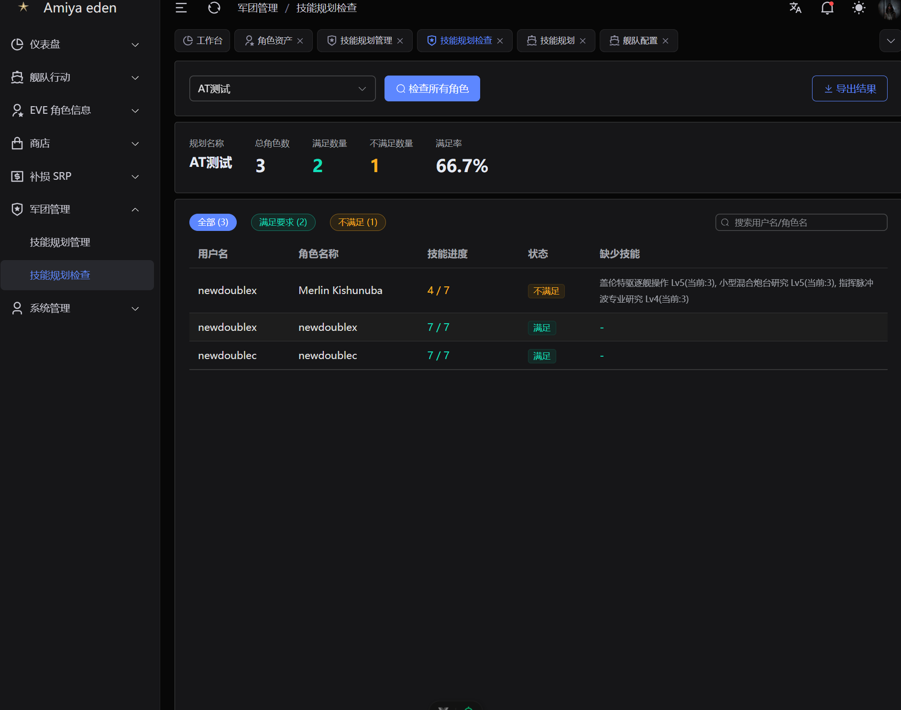
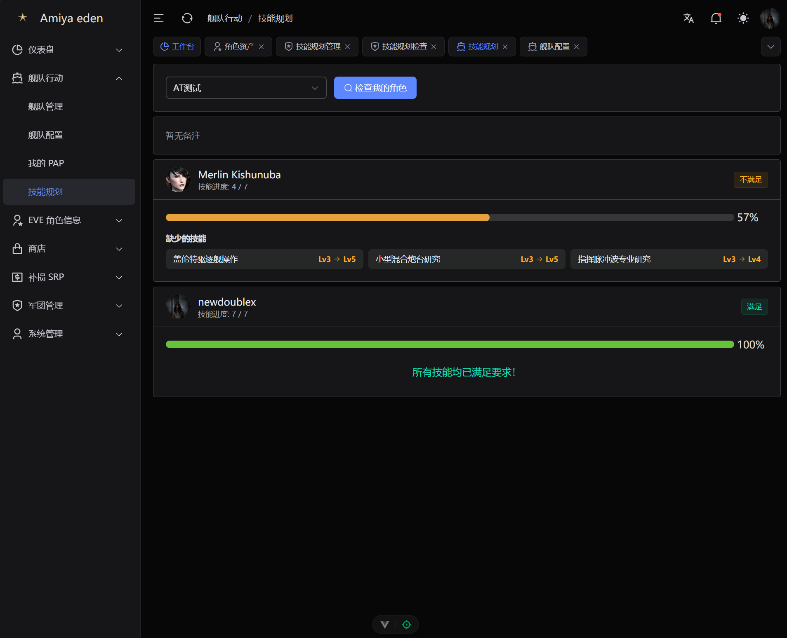

# AmiyaEden

面向 EVE Online Alliance Tournament 队伍的赛训平台。当前分支以 AT 最小加载模式运行；原 AmiyaEden 的商店、旧舰队/PAP、联盟 PAP、SRP、建筑等源码和历史表仍保留，但不会注册路由、菜单或定时任务。

---

## 功能特性

- **双 OAuth 与主角色同步**：EVE SSO、SeAT OAuth；SeAT 主角色优先，仅刷新技能、配置、克隆和植入体。
- **报名与问卷**：不可预测链接、OAuth 回跳、技能/Public 快照、签发者隔离和隐私清理。
- **AT 分数与配置 Set**：导入官方规则 XLSX，版本冻结、禁用船/重复船惩罚、EFT 和电子战/加成替换。
- **比赛状态机**：7v7/10v10、BO3/BO5、报名/指定、逐局阵容、重开、提前结束和重置。
- **比赛服 KM 与 BR**：剪贴板批量提交、独立 KM 表族、15 分钟窗口、冲突审核、清场排除和版本化 BR。
- **战斗日志分析**：成员网页上传 EVE 游戏日志，服务端计算伤害、后勤、电容、采矿、时间序列、目标/舰船/武器拆分，以及输出/承受伤害的命中质量占比；管理员可查看全员报表。
- **贡献账本**：按比赛类型结算、赛季榜单、手工调整和不可变冲正。
- **双重语言**：UI 语言与游戏术语语言独立切换，EFT 始终使用官方英文名称。

---

## 效果预览

1. 总览
    
2. EVE角色绑定管理
    
3. 舰队行动列表：支持舰队邀请
    
4. PAP 查看(军团+联盟)
    
5. 技能列表
    
6. 兑换商店
    
    
7. SRP
    
    
8. ESI 刷新
    
9. 联盟PAP
    
10. 可用舰船技能检查
    
11. 资产列表
    
12. 技能规划检测
    
    

---

## 技术栈

| 层     | 技术                                          |
| ------ | --------------------------------------------- |
| 后端   | Go · Gin · GORM · PostgreSQL · Redis · robfig/cron |
| 前端   | Vue 3 · TypeScript · Vite · Pinia · Vue Router |
| 认证   | EVE SSO OAuth 2.0 · HMAC-SHA256 JWT           |
| 日志   | zap · lumberjack                              |

---

## 环境要求

- Go >= 1.24
- Node.js >= 20.19.0
- pnpm >= 8.8.0
- PostgreSQL
- Redis

---

## 快速开始

### 1. 克隆仓库

```bash
git clone https://github.com/zifox666/AmiyaEden.git
cd AmiyaEden
```

### 2. 配置后端

复制配置模板并填写必要参数：

```bash
cd server
cp config/config.example.yaml config/config.yaml
```

需要修改的关键配置项：

| 配置项 | 说明 |
| --- | --- |
| `database.*` | PostgreSQL 实例连接信息；`data_dbname` 为业务库、`sde_dbname` 为静态数据库 |
| `redis.*` | Redis 连接信息 |
| `jwt.secret` | JWT 签名密钥，生产环境务必修改 |
| `eve_sso.client_id` | EVE 开发者控制台申请的 Client ID |
| `eve_sso.client_secret` | EVE 开发者控制台申请的 Client Secret |
| `eve_sso.callback_url` | SSO 回调地址 |
| `sde.api_key` | SDE 查询接口的 API Key |

### 3. 启动后端

```bash
cd server

# 安装依赖
go mod download

# 运行（使用指定配置文件）
go run main.go -c ./config/config.yaml

# 或使用 Makefile
make run
```

首次启动会分别对 DATA/SDE 执行非破坏性迁移，并自动把 SDE 导入 SDE 数据库。两个数据库必须已存在；Docker 示例会在新数据目录中自动创建。

### 双库部署与备份

DATA 与 SDE 位于同一 PostgreSQL 实例、不同数据库。已有实例可幂等执行：

```bash
psql -U postgres -f deploy/postgres/init-at-databases.sql
```

备份、恢复和恢复后校验：

```bash
pg_dump -Fc -U postgres -d at_data -f at_data.dump
pg_dump -Fc -U postgres -d amiya_eden_sde -f amiya_eden_sde.dump
createdb -U postgres at_data_restore
createdb -U postgres amiya_eden_sde_restore
pg_restore -U postgres -d at_data_restore at_data.dump
pg_restore -U postgres -d amiya_eden_sde_restore amiya_eden_sde.dump
psql -U postgres -d at_data_restore -c "SELECT count(*) FROM at_match;"
psql -U postgres -d amiya_eden_sde_restore -c 'SELECT count(*) FROM "invTypes";'
```

升级已有单库前先完整备份。将配置中的 `data_dbname` 指向原业务库，创建空 SDE 库并启动；程序不会删除旧源码、表或历史数据。`GET /health` 同时检查 DATA、SDE 和 Redis。

### 4. 启动前端

```bash
cd static

# 安装依赖
pnpm install

# 开发模式
pnpm dev

# 构建生产包
pnpm build
```

---

## 项目结构

```text
AmiyaEden/
├── server/                 # Go 后端
│   ├── main.go
│   ├── bootstrap/          # 启动引导（配置/数据库/Redis/路由/定时任务）
│   ├── config/             # 配置定义与配置文件
│   ├── global/             # 全局变量
│   ├── internal/
│   │   ├── handler/        # HTTP 处理器
│   │   ├── service/        # 业务逻辑
│   │   ├── repository/     # 数据访问层
│   │   ├── model/          # GORM 数据模型
│   │   ├── middleware/      # 中间件
│   │   └── router/         # 路由注册
│   ├── jobs/               # 定时任务
│   └── pkg/                # 公共工具包（JWT / ESI / SSO / Cache）
└── static/                 # Vue 3 前端
    └── src/
        ├── api/            # API 调用层
        ├── router/         # 动态路由核心
        ├── store/          # Pinia 状态管理
        └── views/          # 页面视图
```

详细的开发文档请参阅 [DEVELOPER_GUIDE.md](DEVELOPER_GUIDE.md)。

---

## EVE SSO 配置

前往 [EVE 开发者控制台](https://developers.eveonline.com/) 创建应用，回调地址需与配置文件中的 `eve_sso.callback_url` 保持一致。

本地开发默认回调地址：

```text
http://localhost:8080/api/v1/sso/eve/callback
```

---

## 许可证

[LICENSE](LICENSE)
